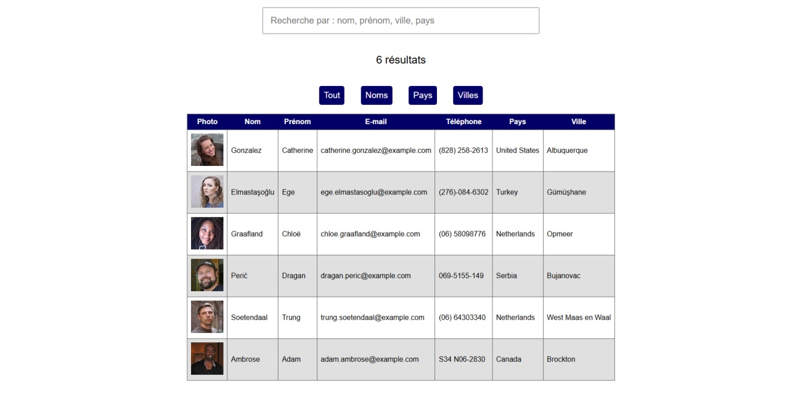

  

## Objectif du projet

Cette application m'a permis de m'exercer sur la création d'un moteur de recherche multi-critères qui permet de retrouver rapidement une personne selon son nom, son prénom, sa ville ou son pays.

### Réalisations techniques

- Découpage de l’interface en composants réutilisables et gestion des données.
- Filtrage des profils au fil de la saisie.
- Appel à une API et gestion du chargement.
- Classement par nom, pays ou ville.
